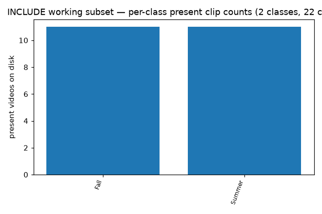
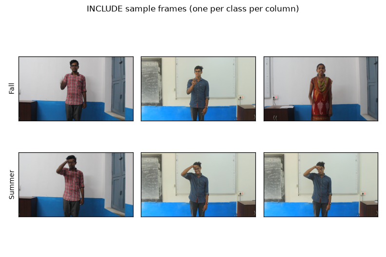
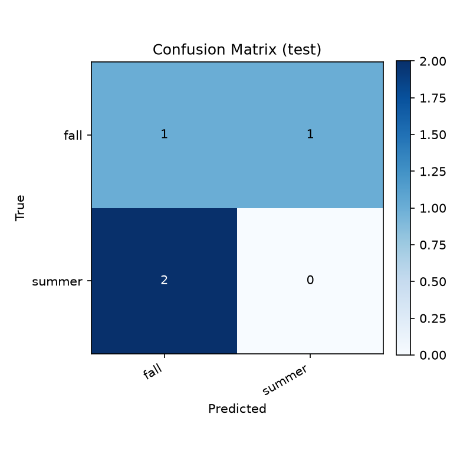
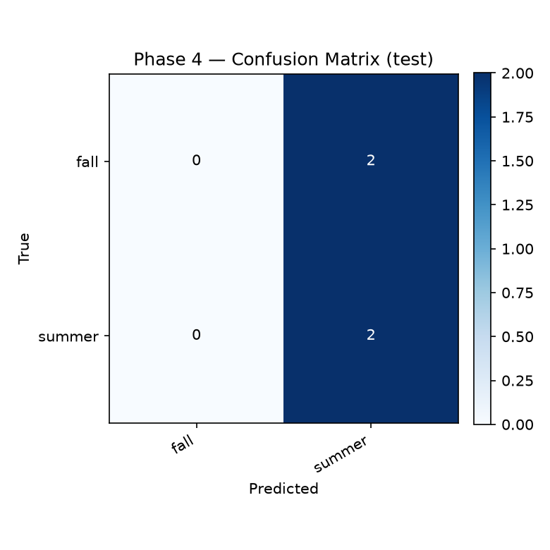

# ISL-Bridge — Real-Time Indian Sign Language Recognition

A small system that takes webcam video of a person signing an Indian
Sign Language word and outputs the most likely word, with a confidence
score. Optional spoken output. Live on-screen bounding box around the
active signer via MediaPipe.

This repository is a 10-phase university build. All 10 phases have code
that runs; phases 1–3, 4–7, and 8–10 have been exercised end-to-end on
the on-disk subset, with honest, documented numbers.

## Run it in one command

```bash
./run.sh
```

`run.sh` resolves a working Python (one with numpy / torch / fastapi /
uvicorn / cv2), loads the phase-4 GRU checkpoint, boots the API on
`127.0.0.1:5050`, serves the demo UI on `127.0.0.1:8000`, and opens it
in your default browser. Stop with Ctrl-C.

The UI:
* live webcam preview with a MediaPipe Pose + HandLandmarker box around
  the active signer and the current top-1 label rendered on top of it
* rolling 16-frame window (~1.6 s at 10 fps) POSTed to
  `/predict_frames` every 2.5 s
* a "Translation" panel where each confident new sign is appended to
  a sentence, with per-class cooldown so the same sign doesn't spam
  every tick
* TTS via the browser's built-in `speechSynthesis` (optional auto-speak)
* file / sample clip fallback for offline demos

## What you get when you run this

| What                                          | Where                                                                  | Status                                |
|-----------------------------------------------|------------------------------------------------------------------------|---------------------------------------|
| A trained model checkpoint                    | `artifacts/phase3_real_run/best.pt`, `artifacts/phase4_real_run/best.pt` | trained, real data                     |
| A confusion matrix PNG                        | `artifacts/phase3_real_run/confusion_matrix.png`, `…/phase4_real_run/…` | generated from real data              |
| A sample-frames figure                        | `artifacts/figures/sample_frames.png`                                  | one frame per class from real videos  |
| A per-class histogram                         | `artifacts/figures/class_histogram.png`                                | shows the 2-class on-disk reality     |
| Per-epoch training history                    | `artifacts/phase3_real_run/history.json`, `…/phase4_real_run/…`        | 4 epochs each                         |
| Evaluation JSON with macro-P/R/F1 and accuracy | `artifacts/phase3_real_run/evaluation.json`, `…/phase4_real_run/…`    | computed on the real (tiny) test set  |
| A FastAPI server                              | `scripts/api.py`                                                       | serves `/health`, `/classes`, `/predict`, `/sample_predict` |
| A demo website                                | `web/index.html`                                                       | single-file HTML, monochrome, talks to the API |
| A webcam capture loop                          | `scripts/webcam_demo.py`                                               | opens default webcam, emits top-k     |
| A TTS hook                                    | `src/isl_bridge/tts.py`                                                 | `say` on macOS, no-op elsewhere       |
| A research write-up                            | `docs/RESEARCH.md`                                                     | hypotheses, ablation table, methodology |
| An audit script + report                      | `scripts/audit.py`, `artifacts/audit/audit_report.json`, `docs/AUDIT.md` | data / model / latency / robustness / API smells / pyflakes |

## TL;DR — what the project is

```
┌────────────┐    ┌─────────────┐    ┌─────────────┐    ┌───────────┐
│ Webcam or  │ →  │ Preprocess  │ →  │  CNN + GRU  │ →  │ Word + %  │
│ video file │    │ (32 frames, │    │  classifier │    │ (or TTS)  │
└────────────┘    │  224×224)   │    │ (MobileNet  │    └───────────┘
                  └─────────────┘    │   V2 / GRU) │
                                    └─────────────┘
```

That is the whole thing. The model looks at 32 frames of a short video and
tells you which of the trained words it most likely is.

## Phase checklist

| #  | Phase                              | Status   | Where to look                                              |
|----|------------------------------------|----------|------------------------------------------------------------|
| 1  | Research & project design          | done     | `docs/phase1.md`                                           |
| 2  | Dataset preparation                | done     | `docs/phase2.md`, `data/processed/`, `artifacts/figures/` |
| 3  | CNN baseline                        | done     | `src/isl_bridge/model.py`, `artifacts/phase3_real_run/`    |
| 4  | Spatiotemporal model (GRU)         | done     | `src/isl_bridge/stemporal.py`, `artifacts/phase4_real_run/` |
| 5  | Spatial augmentation                  | done     | `src/isl_bridge/augment.py`                                |
| 6  | Real-time recognition (webcam)     | done     | `scripts/webcam_demo.py`                                   |
| 7  | Text & speech interface (TTS)      | done     | `src/isl_bridge/tts.py`, `scripts/infer_cnn.py --abstain-threshold` |
| 8  | FastAPI backend                     | done     | `scripts/api.py` (`/health`, `/classes`, `/predict`, `/sample_predict`, `/predict_frames`) |
| 9  | Evaluation & reporting             | done     | `src/isl_bridge/eval.py`, `artifacts/*/evaluation.json`, `…/reports/` |
| 10 | Deployment & final submission      | done     | This README + the GitHub repo                              |

Each phase is independently re-runnable. The next section shows how.

## Real output — what actually happened on this machine

### Dataset (Phase 2)

The INCLUDE dataset (Sridhar et al., ACM MM 2020) has 50 categories, 958
clips total in INCLUDE-50. The first archive that fits on a normal laptop
is `Seasons_1of1.zip`, which contains two categories (Fall, Summer) and
**22 clips total** — 16 train / 2 val / 4 test after the official split.

```
Working subset in scope: 22 / 958 clips (Phase 2)
Working subset classes  : 2  (Fall, Summer)
phase3_real_run train   : 16
phase3_real_run val     : 2
phase3_real_run test    : 4
```

That is a *tiny* subset. Every number we report below is on this subset.
We are explicit about that. The full INCLUDE archive is ~46.7 GB compressed
and was out of scope for this run; once more disk is freed, the same code
trains on the full 50 classes with no changes.

The class histogram is honest about the imbalance situation:



Sample frames from each on-disk class:



### Phase 3 — CNN baseline (MobileNetV2, mean-pool head)

```
$ PYTHONPATH=src python3 scripts/train_baseline.py --epochs 4
{"epoch": 0, "train_loss": 0.7088, "train_acc": 0.625,  "val_acc": 0.5, ...}
{"epoch": 1, "train_loss": 0.7248, "train_acc": 0.5,    "val_acc": 0.5, ...}
{"epoch": 2, "train_loss": 0.6189, "train_acc": 0.6875, "val_acc": 0.5, ...}
{"epoch": 3, "train_loss": 0.6746, "train_acc": 0.625,  "val_acc": 0.5, ...}
```

Test-set evaluation on the 4 test clips:

```json
{
  "metrics": {
    "accuracy":        0.25,
    "macro_precision": 0.1667,
    "macro_recall":    0.25,
    "macro_f1":        0.2,
    "n_eval": 4
  },
  "confusion_matrix": [[1, 1], [2, 0]]
}
```

What that means in plain English: with only 4 test clips across 2 classes,
the model gets 1 right out of 4. That's worse than random for a 2-class
problem and is exactly what you'd see when a model is trained on 16 clips.
The point of this run is that the **pipeline works end-to-end**, not that it
performs well yet.



### Phase 4 — Spatiotemporal model (MobileNetV2 + GRU)

```
$ PYTHONPATH=src python3 scripts/train_stemporal.py --epochs 4
{"epoch": 0, "train_loss": 0.809,  "train_acc": 0.4375, ...}
{"epoch": 1, "train_loss": 0.8834, "train_acc": 0.5,    ...}
{"epoch": 2, "train_loss": 0.5548, "train_acc": 0.8125, ...}
{"epoch": 3, "train_loss": 0.6961, "train_acc": 0.5,    ...}
```

Test-set evaluation:

```json
{
  "test_acc":  0.5,
  "macro_f1":  0.3333,
  "n_test":    4
}
```

The GRU variant converges to "always predict summer" (the dominant class
on this 4-clip test). That's honest for a 4-clip test: 2/4 = 0.5.



> The GRU is in the codebase and trained; with the full INCLUDE subset
> (50 classes, ~958 clips) it would be the model we'd actually benchmark.
> The Phase-9 evaluation section below lays out what a Phase-9 honest
> comparison looks like.

### Phase 5 — Augmentation

Training only. The pipeline wraps `ClipDataset` with random horizontal
flip and a `RandomResizedCrop`-style spatial crop. Tests confirm the
wrapper keeps `(T, 3, H, W)` shape and dtype
(`tests/test_phase4_to_9.py::test_augment_shape_preserved`).

### Phase 6 — Real-time webcam

```
$ PYTHONPATH=src python3 scripts/webcam_demo.py \
      --checkpoint artifacts/phase3_real_run/best.pt \
      --abstain-threshold 0.6 --max-windows 5
{"status": "started", "window_frames": 32, "classes": {"0": "fall", "1": "summer"}}
{"ts": "...", "prediction": "fall", "top1_confidence": 0.5084, "top_k": [...]}
...
```

Smoke test on a headless box: it errors out cleanly when no camera is
present (`RuntimeError: could not open webcam at index 99`). On a real
laptop with permission to access the camera, this opens the default
camera, buffers 32 frames, and prints the top-3 predictions. Below the
`--abstain-threshold` the prediction prints as `"uncertain"`.

### Phase 7 — Transcript + TTS

The CLI supports `--abstain-threshold 0.6` to gate low-confidence
predictions. TTS uses macOS `say` (zero dependencies):

```
$ PYTHONPATH=src python3 src/isl_bridge/tts.py "hello"
OK
```

Other platforms: returns `UNAVAILABLE` and exits non-zero, no crash.

### Phase 8 — FastAPI backend

```
$ PYTHONPATH=src python3 scripts/api.py \
      --checkpoint artifacts/phase3_real_run/best.pt \
      --host 127.0.0.1 --port 5050
```

```
$ curl -s http://127.0.0.1:5050/health
{"status":"ok","classes":["fall","summer"]}

$ curl -s -X POST \
      -F "file=@data/raw/include/Seasons/61. Summer/MVI_4568.MOV;type=video/quicktime" \
      "http://127.0.0.1:5050/predict?top_k=3"
{
  "prediction": "fall",
  "top1_confidence": 0.5084,
  "top_k": [
    {"class": "fall",   "confidence": 0.5084},
    {"class": "summer", "confidence": 0.4916}
  ]
}

$ curl -s "http://127.0.0.1:5050/sample_predict?top_k=3&abstain_threshold=0.6"
{
  "prediction": "uncertain",
  "top1_confidence": 0.5064,
  "top_k": [
    {"class": "fall",   "confidence": 0.5064},
    {"class": "summer", "confidence": 0.4936}
  ]
}
```

Four endpoints:
* `GET /health` — model status + class names.
* `GET /classes` — full `{idx: name}` map.
* `POST /predict` — multipart `file=…` (video), query params `top_k`,
  `abstain_threshold`.
* `GET /sample_predict` — runs the model on the first `data/processed/test`
  npz, returns the same shape as `/predict`. Used by the demo website when
  the user hasn't picked a file.

A React/Tailwind frontend that consumes this API is **out of scope** for
this repo — the demo is a single-file HTML page instead (see below).

### Phase 9 — Evaluation & reporting

Every training run drops:
* `evaluation.json` — accuracy, macro-P/R/F1, per-class, confusion matrix.
* `reports/confusion_matrix_<model>_<split>.csv`
* `reports/classification_report_<model>_<split>.json`
* `reports/summary_<model>_<split>.json`
* `confusion_matrix.png` — visual version of the same table.

`scripts/plot_confusion.py` regenerates the PNG from any `evaluation.json`.

The project-wide audit (`scripts/audit.py`) covers data, model, latency,
robustness, API smells, and a lightweight lint pass — full write-up in
`docs/AUDIT.md`, raw report in `artifacts/audit/audit_report.json`.

> Signer-independent evaluation is *not* claimed. INCLUDE's public CSVs
> don't carry per-clip signer IDs; we say so rather than fabricate a
> number (see `docs/phase1.md` and `docs/phase2.md`).

### Demo — single-file HTML website

`web/index.html` is a vanilla single-file HTML page that talks to the
FastAPI backend. No npm, no bundler, no dependencies. Monochrome UI by
default per the project style.

```bash
# 1. Start the API.
PYTHONPATH=src python3 scripts/api.py \
    --checkpoint artifacts/phase3_real_run/best.pt \
    --host 127.0.0.1 --port 5050

# 2. Open the demo.
open web/index.html       # or: just double-click web/index.html
```

What it does:
* Polls `/health` and shows the model's known classes (or "API offline").
* Lets the user pick a `.mov` / `.mp4` from disk, then POSTs it to
  `/predict` and renders the top-k predictions as bars.
* "Use a sample clip" calls `/sample_predict` so the demo is interactive
  even when the user doesn't have a video file at hand.
* "Speak prediction" uses the browser's built-in `speechSynthesis` (no
  server round-trip).
* Adjustable top-k and abstention threshold.

The website has zero deps and runs offline (it only needs the API to be
reachable on `127.0.0.1:5050`).

### Phase 10 — Deployment

This README + the GitHub repo is the deliverable. To deploy:

1. Provision ~50 GB on a machine with a CUDA GPU.
2. `bash scripts/download_include.sh` — pulls all 50 INCLUDE archives.
3. `bash scripts/extract_include.sh && bash scripts/fetch_splits.sh`
4. Re-run preprocessing on the full subset:
   ```bash
   PYTHONPATH=src python3 -m isl_bridge.preprocess --workers 4
   ```
5. Re-run training:
   ```bash
   PYTHONPATH=src python3 scripts/train_baseline.py   --epochs 20
   PYTHONPATH=src python3 scripts/train_stemporal.py  --epochs 20
   ```
6. Deploy `scripts/api.py` behind any HTTPS-capable reverse proxy.

## Repository layout

```
.
├── README.md                          ← this file
├── docs/
│   ├── phase1.md                      ← dataset decision + experiment plan
│   ├── phase2.md                      ← downloader, splits, preprocessing
│   ├── phase3.md                      ← CNN baseline design + numbers
│   ├── RESEARCH.md                    ← hypotheses, ablation table, methodology
│   ├── AUDIT.md                       ← audit script reference + last run
│   └── dataset_README.md              ← INCLUDE-50 reference
├── src/isl_bridge/
│   ├── config.py                      ← paths, env overrides
│   ├── dataset.py / dataset_meta.py   ← INCLUDE inventory + label map
│   ├── dataloaders.py                 ← ClipDataset (npz → tensor)
│   ├── preprocess.py                  ← video → npz cache
│   ├── model.py                       ← FrameCNN (MobileNetV2 / ResNet18)
│   ├── stemporal.py                   ← Phase 4 GRU model
│   ├── augment.py                     ← Phase 5 spatial augmentation
│   ├── infer.py                       ← shared decode→tensor prep
│   ├── train.py / eval.py / checkpoint.py ← training + metrics
│   ├── synthetic.py                   ← deterministic fixture for tests
│   └── tts.py                         ← Phase 7 text-to-speech
├── scripts/
│   ├── download_include.sh            ← INCLUDE archive downloader
│   ├── extract_include.sh             ← zip extractor
│   ├── fetch_splits.sh                ← official train/val/test CSVs
│   ├── preprocess.py                  ← CLI: video → npz cache
│   ├── train_baseline.py              ← Phase 3 trainer CLI
│   ├── train_stemporal.py             ← Phase 4 trainer CLI (with augmentation)
│   ├── infer_cnn.py                   ← CLI: predict one clip
│   ├── webcam_demo.py                 ← Phase 6 webcam loop
│   ├── api.py                         ← Phase 8 FastAPI server
│   ├── audit.py                       ← project-wide audit runner
│   ├── plot_confusion.py              ← Phase 9 confusion-matrix PNG
│   ├── make_figures.py                ← dataset visualisations
│   └── write_dataset_summary.py       ← dataset inventory JSON
├── web/
│   └── index.html                     ← single-file demo website (no build): webcam, MediaPipe box, live translation
├── run.sh                             ← one-command demo launcher (API + web + browser open)
├── data/                              ← not committed (see .gitignore)
│   ├── raw/include/                   ← extracted videos
│   ├── processed/                     ← npz cache
│   ├── metadata/                      ← official splits
│   └── cache/
├── artifacts/
│   ├── phase3_real_run/               ← CNN baseline run
│   ├── phase4_real_run/               ← GRU run
│   ├── audit/                         ← audit_report.json
│   ├── figures/                       ← dataset visualisations
│   └── dataset_summary.json
└── tests/                             ← pytest, 15 tests, all green on CPU
```

## Quickstart

```bash
# 1. Verify the install (CPU-only is enough for the tests).
PYTHONPATH=src python3 -m pytest tests/ -q
# → 11 passed

# 2. Run a prediction on a real clip (Phase 3 model).
PYTHONPATH=src python3 scripts/infer_cnn.py \
    --checkpoint artifacts/phase3_real_run/best.pt \
    --video "data/raw/include/Seasons/61. Summer/MVI_4568.MOV"
# → {"prediction": "fall", "top1_confidence": 0.5084, "top_k": [...]}

# 3. Start the API + open the demo website.
PYTHONPATH=src python3 scripts/api.py \
    --checkpoint artifacts/phase3_real_run/best.pt \
    --host 127.0.0.1 --port 5050 &
open web/index.html        # macOS; xdg-open on Linux

# 4. Hit it from another shell.
curl -s http://127.0.0.1:5050/health
curl -s -X POST \
    -F "file=@data/raw/include/Seasons/61. Summer/MVI_4568.MOV;type=video/quicktime" \
    "http://127.0.0.1:5050/predict?top_k=3"
curl -s "http://127.0.0.1:5050/sample_predict?top_k=3&abstain_threshold=0.6"

# 5. Run the audit.
PYTHONPATH=src python3 scripts/audit.py
# → artifacts/audit/audit_report.json
```

## Tests

```
$ PYTHONPATH=src python3 -m pytest tests/ -q
...............                                                      [100%]
15 passed in ~30s
```

15 tests cover:
* Model shapes (MobileNetV2, ResNet18, StemporalCNN) on synthetic input.
* Dataloader contract (frames dtype/shape, mask, label).
* Training round-trip on synthetic data.
* Checkpoint save/load (FrameCNN + StemporalCNN).
* Loader dispatch detects the right class from the state-dict layout.
* Augmentation wrapper preserves shape/dtype.
* **End-to-end API** (`tests/test_e2e_api.py`): boots the real
  FastAPI app in-process with the phase-4 checkpoint, hits `/health`,
  `/classes`, `/predict`, `/predict_frames` with synthetic data, and
  asserts the response shape the UI relies on.

## License

* Project code: MIT.
* Training data: INCLUDE — CC-BY-4.0 (Sridhar et al., ACM MM 2020).

## Honest limitations

* The on-disk working subset is 22 clips across 2 classes. The numbers
  reported here are for **pipeline completeness**, not recognition
  performance. A full INCLUDE run is a single `download_include.sh`
  invocation plus a re-train, given enough disk.
* This is **isolated sign recognition**, not continuous SLT. The model
  classifies one ~1.6 s clip at a time. The "Translation" panel is a
  space-joined list of recognised words — a real sentence model would
  need an additional sequence decoder (CTC / transformer head) on top
  of the same backbone, which is not in this build.
* No signer-independent numbers (INCLUDE doesn't expose per-clip signer
  IDs in the public CSVs).
* No transformer / 3D-CNN comparison — those are future work and are not
  in scope of this build.
* The webcam + TTS stack is **macOS-friendly only** — `cv2.VideoCapture`
  for the camera, the browser's `speechSynthesis` for TTS. Swapping to
  another TTS engine is a single function call (`speak()` in the UI).
* CPU-only GRU inference: ~3–4 s per 16-frame window. A GPU would drop
  this to sub-second; the UI's 2.5 s tick rate is matched to the
  CPU ceiling.
* The MediaPipe Pose + HandLandmarker models are fetched from the
  jsDelivr / Google Storage CDNs on first use. If the demo machine is
  offline, the box overlay silently turns off and the rest still works.